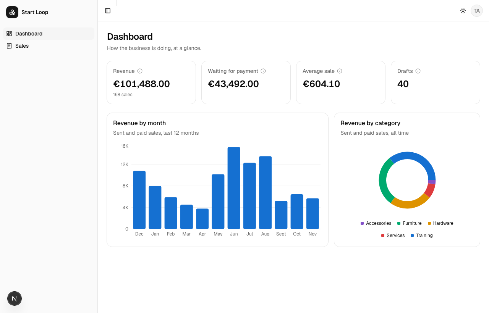

# start-loop

A starter for building your company's own business app (an ERP) with Claude Code. It begins as
a dashboard and a **Sales** module, and grows one module at a time: customers, products, stock,
invoices, whatever the business runs on today in spreadsheets.

- **Works with your Google Sheets from day one**, and moves to a real database module by module when you are ready. Each module can live in Postgres, Google Sheets, or both side by side.
- **Built like a professional app:** sign-in with roles, validation on screen and on the server, money handled in cents, tests that click through the app on a phone and a desktop, light and dark themes.
- **Made to be extended with Claude Code:** the rules, patterns and lessons from three production projects are written in `AGENTS.md` and `docs/`, and Claude has ready-made skills for the common jobs.



Stack: Next.js 16 · React 19 · TypeScript · Tailwind CSS 4 · shadcn/ui · Drizzle + Postgres ·
Google Sheets API · Better Auth · Vitest · Playwright. Why each: `docs/DECISIONS.md`.

## Start (about 5 minutes)

You need a Mac, Linux or Windows (WSL) machine with **git**, **nvm** ([install](https://github.com/nvm-sh/nvm))
and, to build with Claude, **[Claude Code](https://claude.com/claude-code)**. Then, in this folder:

```bash
./setup.sh
```

It installs everything and skips what is already done, so it is safe to run again: Node 22, pnpm,
the packages and git hooks, `.env.local` with a fresh secret, the browser for the UI tests, a local
Postgres with its tables, and a final check. (Or open the folder in Claude Code and say
"set it up": it runs `/setup`.) Then:

```bash
pnpm dev
```

Open http://localhost:3000, create your account (the first one becomes the admin), and in a second
terminal add demo data so the dashboard has something to show:

```bash
pnpm db:seed
```

### Claude Code mod: reflect

When you open the folder in Claude Code and trust it, Claude Code offers to install **reflect-mod**
(listed in `.claude/settings.json`): when you correct Claude ("no, use cents"), it shows the rule it
found above the prompt, and one click saves it to `CLAUDE.md`, so the next session already knows.
Accept it. If you missed the offer:

```bash
claude plugin marketplace add bayramannakov/claude-reflect
claude plugin install reflect-mod@claude-reflect-marketplace
```

It needs a recent Claude Code (`claude update`); restart Claude Code after installing. Use it
instead of the older `claude-reflect` plugin, not both.

## Build it with Claude Code

Open the folder in Claude Code and ask in plain words. Good first requests:

- "Connect the Sales module to my Google Sheet" → runs `/connect-sheet`
- "Add a Customers module with name, email, phone, city and a VIP checkbox" → runs `/new-module`
- "Show the top 5 customers by revenue on the dashboard"
- "Move Sales from the sheet into the database" → runs `/move-to-postgres`
- "Check the new page on a phone" → runs `/verify-ui`
- "Ship it" → runs `/ship` (pull request with all checks)

Claude follows `AGENTS.md`. You don't need to know the rules, but skim `docs/LESSONS.md` once: it is
the list of mistakes this setup exists to prevent.

## Everyday commands

| Command                          | What it does                                                              |
| -------------------------------- | ------------------------------------------------------------------------- |
| `pnpm dev`                       | runs the app and its local database                                       |
| `pnpm check`                     | types, lint and tests (run before committing; the git hooks run them too) |
| `pnpm test:e2e`                  | clicks through the app in a real browser, on desktop and phone            |
| `pnpm build`                     | the production build                                                      |
| `pnpm db:generate`               | after changing a table: creates the database migration                    |
| `pnpm sheets:check sales`        | checks a Google Sheets tab before connecting it                           |
| `pnpm sheets:copy sales --apply` | copies a module from Sheets into the database                             |

## Where to read more

|                           |                                                       |
| ------------------------- | ----------------------------------------------------- |
| `AGENTS.md`               | the rulebook (for Claude and for you)                 |
| `docs/DATA-SOURCES.md`    | Google Sheets setup, hybrid mode, moving to Postgres  |
| `docs/ADDING-A-MODULE.md` | how a module is built                                 |
| `docs/DESIGN-SYSTEM.md`   | colours, components, screen patterns                  |
| `docs/TESTING.md`         | what is tested and how                                |
| `docs/GIT-WORKFLOW.md`    | branches, pull requests, versions                     |
| `docs/DEPLOYMENT.md`      | putting it online (Vercel + Postgres)                 |
| `docs/LESSONS.md`         | 60 mistakes from real projects, and the rule for each |
